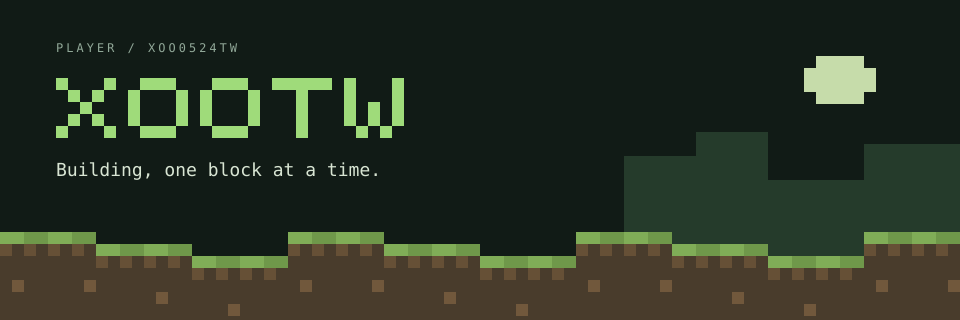

  

  <strong>Student · Minecraft developer · Learning reverse engineering</strong>

  <a href="https://www.allenpixel.net">Website</a> &nbsp;·&nbsp;
  <a href="mailto:allenmc.su@gmail.com">Email</a> &nbsp;·&nbsp;
  Discord: <code>xoo.tw</code>

---

### Hey, I'm xootw.

I build Minecraft Java Edition clients and server plugins. Java is my main language, and I'm learning reverse engineering to better understand how software works under the hood.

I also work with Python and Go, and I'm currently learning Rust.

**Languages I speak:** English / 繁體中文

### In my inventory

| Main tool | Also using | Learning |
| :--- | :--- | :--- |
| Java | Python · Go | Rust · Reverse engineering |

### A few blocks of progress

  

  

---

  Building, one block at a time.

