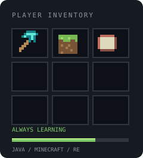

# 👋 Hey, I'm xootw

### Student · Minecraft Java Developer

Building Minecraft clients and server plugins, and learning how software works under the hood.

<p>
  <a href="https://www.allenpixel.net"></a>
  <a href="mailto:allenmc.su@gmail.com"></a>
  
</p>

---

## 🧩 About Me



```yaml
name: xootw
role: Student

building:
  - Minecraft Java Edition clients
  - Minecraft server plugins

main_language: Java
also_using: [Python, Go]

currently_learning:
  - Reverse engineering
  - Rust

languages:
  - English
  - Traditional Chinese (繁體中文)
```

<br clear="both" />

## 🛠️ Tech Stack

### Main Language


### Also Using


### Currently Learning


**Rust & Reverse Engineering**

---

## ⛏️ What I'm Working On

- **Minecraft clients** — building features for Minecraft Java Edition.
- **Server plugins** — extending Minecraft servers with custom functionality.
- **Reverse engineering** — learning to read, inspect and understand existing software.

---

## 📊 GitHub Analytics

<p align="center">
  <a href="https://github.com/xoo0524tw?tab=overview">
    
  </a>
</p>

<p align="center">
  <a href="https://github.com/xoo0524tw?tab=overview">
    
  </a>
</p>

---

## 📬 Let's Connect

```text
Website  : https://www.allenpixel.net
Discord  : xoo.tw
Email    : allenmc.su@gmail.com
```

<p align="center">
  <sub>Crafting code. Exploring internals.</sub>
</p>

